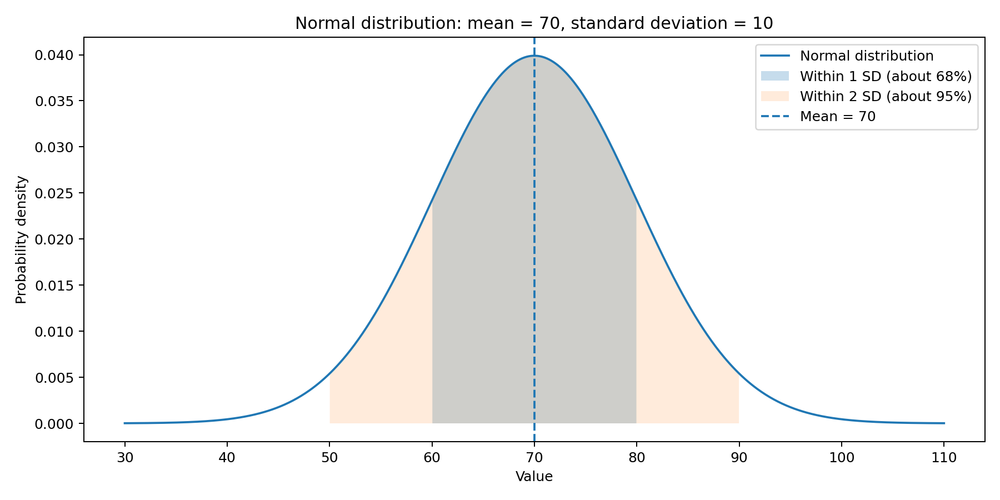
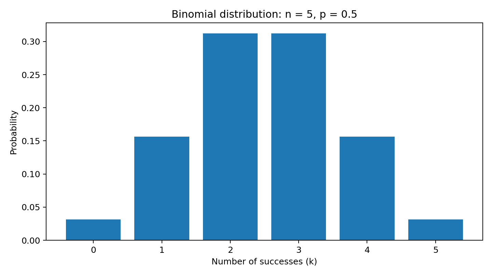
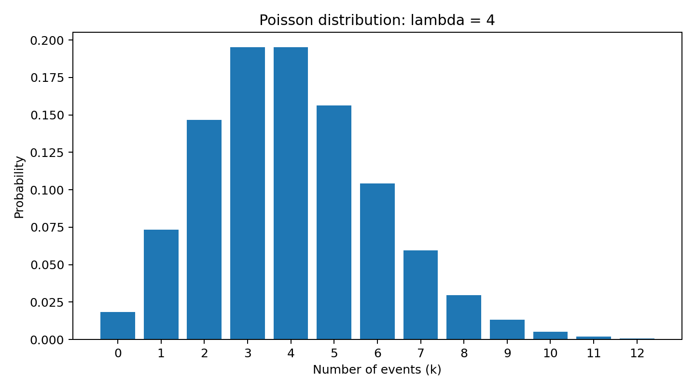

# Statistics — 21 November Class Notes

> **Revision guide based on the professor's handwritten `21 nov.pdf`.**
> The professor's topics, formulas and worked examples are kept as the
> foundation. Additional explanations, calculations and Python examples
> are clearly identified so that you can revise both the class material
> and its AI/ML applications.

## How to read this document

- **🧑‍🏫 Professor's notes** — content and examples visible in the class PDF.
- **💡 Explanation / extra practice** — added explanations to clarify the mathematics.
- **🐍 Python** — implementation of the concept.
- **🤖 AI/ML connection** — where the concept is useful in machine learning.

## Folder structure

```text
Day_9_21_Nov_26_C9_Statistics/
│
├── README.md
│
└── images/
    ├── normal_distribution.png
    ├── binomial_distribution.png
    └── poisson_distribution.png
```

The image links in this README are **relative paths**. Keep the `images`
folder beside `README.md` so that GitHub can display the graphs.

---

## Contents

1. [Statistics: three areas](#1-statistics-three-areas)
2. [Descriptive statistics](#2-descriptive-statistics)
3. [Mean / average](#3-mean--average)
4. [Median](#4-median)
5. [Mode](#5-mode)
6. [Measures of dispersion](#6-measures-of-dispersion)
   - [Range](#61-range)
   - [Variance](#62-variance)
   - [Standard deviation](#63-standard-deviation)
7. [Normal distribution](#7-normal-distribution)
8. [Binomial distribution](#8-binomial-distribution)
9. [Poisson distribution](#9-poisson-distribution)
10. [Compare the three distributions](#10-compare-the-three-distributions)
11. [Python revision notebook](#11-python-revision-notebook)
12. [Formula sheet](#12-formula-sheet)
13. [Practice questions](#13-practice-questions)

---

# 1. Statistics: three areas

🧑‍🏫 **Professor's notes**

The professor lists three broad areas:

1. Descriptive statistics
2. Inferential statistics
3. Probability and statistical modelling

💡 **Explanation**

| Area | Main purpose | Example |
|---|---|---|
| Descriptive statistics | Summarise the data we have | Calculate the average mark of a class |
| Inferential statistics | Use a sample to draw conclusions about a population | Survey a sample of voters to estimate public opinion |
| Probability and statistical modelling | Describe uncertainty and random outcomes mathematically | Estimate the chance of a customer purchasing a product |

**Learning idea:** Descriptive statistics helps us understand the data. Probability describes uncertainty. Inferential statistics uses sample information to make conclusions about a wider population.

# 2. Descriptive statistics

🧑‍🏫 **Professor's notes**

The professor groups descriptive statistics into two parts:

### A. Measures of central tendency

These describe **where the data is centred**.

- Mean
- Median
- Mode

### B. Measures of dispersion

These describe **how spread out the data is**.

- Range
- Variance
- Standard deviation

💡 **Why do we need both?**

Consider:

```text
Dataset A = [70, 75, 80, 85, 90]
Dataset B = [20, 50, 80, 110, 140]
```

Both datasets have a mean of 80:

$$
Mean(A)=Mean(B)=80
$$

However, Dataset B is much more spread out. The mean alone does not describe the full distribution of the data.

---

# 3. Mean / average

🧑‍🏫 **Professor's notes — definition and formula**

Mean is calculated by dividing the sum of all observations by the number of observations.

$$
\boxed{\bar{x}=\frac{\sum_{i=1}^{n}x_i}{n}}
$$

| Symbol | Meaning |
|---|---|
| $\bar{x}$ | Sample mean |
| $x_i$ | An individual observation |
| $\sum$ | Summation: add the observations |
| $n$ | Number of observations |

For an entire population, the notation is:

$$
\boxed{\mu=\frac{\sum_{i=1}^{N}x_i}{N}}
$$

Here, $\mu$ is the population mean and $N$ is the population size.

## 3.1 Professor's example — marks

🧑‍🏫 The professor uses:

$$
[60,70,80,90,100]
$$

**Step 1 — Add all observations**

$$
60+70+80+90+100=400
$$

**Step 2 — Count the observations**

$$
n=5
$$

**Step 3 — Divide the sum by the count**

$$
\bar{x}=\frac{400}{5}=\boxed{80}
$$

**Result: Mean = 80.**

## 3.2 Professor's example — Average Order Value (AOV)

🧑‍🏫 The notes list five order values:

| Customer | Order value |
|---|---:|
| A | 500 |
| B | 700 |
| C | 800 |
| D | 1,000 |
| E | 2,000 |
| **Total** | **5,000** |

$$
AOV=\frac{500+700+800+1000+2000}{5}
$$

$$
AOV=\frac{5000}{5}=\boxed{1000}
$$

The average order value is 1,000.

## 3.3 Professor's outlier example

🧑‍🏫 The professor then adds customer F, whose order value is **1,000,000**.

```text
[500, 700, 800, 1000, 2000, 1000000]
```

The new average is:

$$
AOV=\frac{500+700+800+1000+2000+1000000}{6}
$$

$$
AOV=\frac{1005000}{6}=\boxed{167500}
$$

Compare the two results:

| Situation | AOV |
|---|---:|
| Five original orders | 1,000 |
| After adding the 1,000,000 order | 167,500 |

**What is an outlier?**

An outlier is an observation that is unusually far from the other observations.

💡 **Why is this important?** The mean is sensitive to extreme values. One very large order pulls the average upward, even though most customers' orders are much smaller.

### Professor's 40% net-profit calculation

The notes also show 40% of the AOV:

Before adding the outlier:

$$
\frac{40}{100}\times1000=\boxed{400}
$$

After adding the outlier:

$$
\frac{40}{100}\times167500=\boxed{67000}
$$

This illustrates how an outlier can strongly affect a business calculation based on the average.

## 3.4 Python implementation

```python
orders = [500, 700, 800, 1000, 2000]

mean = sum(orders) / len(orders)
print("AOV before outlier:", mean)

orders.append(1_000_000)

new_mean = sum(orders) / len(orders)
print("AOV after outlier:", new_mean)
```

Expected output:

```text
AOV before outlier: 1000.0
AOV after outlier: 167500.0
```

## 3.5 AI/ML connection

- **Mean imputation:** Fill a missing numerical value with the feature mean when appropriate.
- **Mean centering:** Subtract the feature mean from each observation.
- **PCA:** Uses variation around feature means to identify important directions in the data.

**Caution:** Mean imputation can be misleading when a feature is highly skewed or contains influential outliers. Median imputation may be more appropriate in those cases.

---

# 4. Median

🧑‍🏫 **Professor's notes — definition**

Median is the **middle value** after arranging the observations in ascending or descending order.

**Important rule: Sort the data before finding the median.**

## 4.1 Odd number of observations

🧑‍🏫 Professor's example:

```text
Original: [10, 18, 5, 9, 25]
Sorted:   [5, 9, 10, 18, 25]
```

There are five observations. The middle position is:

$$
\frac{n+1}{2}=\frac{5+1}{2}=3
$$

The third value is 10.

$$
\boxed{Median=10}
$$

## 4.2 Even number of observations

💡 **Additional explanation**

If there is an even number of observations, there are two middle values. Take their average.

Example:

```text
Original: [10, 18, 5, 9, 25, 2]
Sorted:   [2, 5, 9, 10, 18, 25]
```

The two middle values are 9 and 10.

$$
Median=\frac{9+10}{2}=\boxed{9.5}
$$

## 4.3 Median formulas

For odd $n$:

$$
\boxed{Median=X_{\left(\frac{n+1}{2}\right)}}
$$

For even $n$:

$$
\boxed{Median=\frac{X_{(n/2)}+X_{(n/2+1)}}{2}}
$$

Here, $X_{(i)}$ means the value at position $i$ **after sorting**.

## 4.4 Why is median useful when outliers exist?

Example:

```text
Original data: [500, 700, 800, 1000, 2000]
Median = 800

After adding an outlier:
[500, 700, 800, 1000, 2000, 1000000]
Median = (800 + 1000) / 2 = 900
```

The median changes from 800 to 900, while the mean changes from 1,000 to 167,500.

**Remember:** Median is generally less affected by extreme values than mean.

## 4.5 Python implementation

```python
import numpy as np

odd_data = [10, 18, 5, 9, 25]
even_data = [10, 18, 5, 9, 25, 2]

print("Odd median:", np.median(odd_data))
print("Even median:", np.median(even_data))
```

Manual implementation:

```python
data = [10, 18, 5, 9, 25, 2]

data.sort()
n = len(data)

if n % 2 == 1:
    median = data[n // 2]
else:
    left = data[n // 2 - 1]
    right = data[n // 2]
    median = (left + right) / 2

print("Sorted data:", data)
print("Median:", median)
```

## 4.6 AI/ML connection

- Median imputation for numerical missing values.
- Summarising skewed data.
- Robust exploratory data analysis.
- Describing typical salaries, prices and transaction amounts when outliers exist.

---

# 5. Mode

🧑‍🏫 **Professor's notes — definition and example**

Mode is the value that occurs most frequently.

The professor's example is:

$$
[2,3,4,5,6,7,8,7,6,5,5,1]
$$

Count the occurrences:

| Value | Frequency |
|---:|---:|
| 1 | 1 |
| 2 | 1 |
| 3 | 1 |
| 4 | 1 |
| 5 | 3 |
| 6 | 2 |
| 7 | 2 |
| 8 | 1 |

The value 5 appears three times, more than any other value.

$$
\boxed{Mode=5}
$$

## 5.1 Types of mode

💡 **Additional explanation**

| Type | Meaning | Example |
|---|---|---|
| Unimodal | One mode | `[1, 2, 2, 3]` → 2 |
| Bimodal | Two modes | `[1, 2, 2, 3, 3]` → 2 and 3 |
| Multimodal | More than two modes | `[1,1,2,2,3,3]` → 1, 2 and 3 |
| No repeated mode | No value occurs more often than the others | `[1,2,3,4]` |

## 5.2 Python implementation

```python
from statistics import multimode

data = [2, 3, 4, 5, 6, 7, 8, 7, 6, 5, 5, 1]

print("Mode:", multimode(data))
```

Output:

```text
Mode: [5]
```

## 5.3 AI/ML connection

Mode is useful for categorical data.

Example:

```python
payment_methods = ["Card", "Cash", "Card", "Card", "Cash"]
```

The mode is `"Card"`. It can be used as a simple replacement for a missing categorical value when appropriate.

---

# 6. Measures of dispersion

🧑‍🏫 **Professor's notes**

The professor identifies these measures of dispersion:

- Range
- Variance
- Standard deviation

They describe how spread out the data is.

## 6.1 Range

💡 **Definition**

Range is the difference between the maximum and minimum values.

$$
\boxed{Range=X_{\max}-X_{\min}}
$$

Example:

$$
[10,20,30,40,50]
$$

$$
Range=50-10=\boxed{40}
$$

Python:

```python
data = [10, 20, 30, 40, 50]

data_range = max(data) - min(data)
print("Range:", data_range)
```

**Limitation:** Range uses only the two extreme values. It does not describe how the other observations are distributed and is sensitive to outliers.

## 6.2 Variance

🧑‍🏫 **Professor's notes — Class A and Class B**

The professor compares two classes:

```text
Class A = [70, 75, 80, 85, 90]
Class B = [20, 50, 80, 110, 140]
```

Both classes have the same mean:

$$
Mean(A)=Mean(B)=80
$$

However, the observations in Class B are more spread out.

### Why do we subtract the mean and square the differences?

For Class A:

$$
Mean=80
$$

| Observation $x_i$ | Deviation $x_i-80$ | Squared deviation |
|---:|---:|---:|
| 70 | -10 | 100 |
| 75 | -5 | 25 |
| 80 | 0 | 0 |
| 85 | 5 | 25 |
| 90 | 10 | 100 |
| **Total** | **0** | **250** |

The deviations add up to zero because positive and negative differences cancel each other.

Squaring makes every squared deviation non-negative.

### Population variance formula

🧑‍🏫 **The professor's Class A calculation divides by 5, so this is population variance.**

$$
\boxed{\sigma^2=\frac{\sum_{i=1}^{N}(x_i-\mu)^2}{N}}
$$

Where:

| Symbol | Meaning |
|---|---|
| $\sigma^2$ | Population variance |
| $x_i$ | Individual observation |
| $\mu$ | Population mean |
| $N$ | Number of population observations |

For Class A:

$$
\sigma^2=\frac{100+25+0+25+100}{5}
$$

$$
\sigma^2=\frac{250}{5}=\boxed{50}
$$

### Sample variance — important additional distinction

When observations are a sample used to estimate the variance of a larger population, the usual unbiased sample variance is:

$$
\boxed{s^2=\frac{\sum_{i=1}^{n}(x_i-\bar{x})^2}{n-1}}
$$

For the same Class A values:

$$
s^2=\frac{250}{5-1}=\boxed{62.5}
$$

**Do not confuse the denominators:**

- Population variance: divide by $N$.
- Sample variance: divide by $n-1$.

### Class B variance — additional calculation

The professor writes Class B and its mean (80), while the detailed variance table is shown for Class A. The following Class B variance is an additional calculation for comparison.

Class B:

$$
[20,50,80,110,140]
$$

Mean:

$$
\mu=80
$$

Deviations:

$$
[-60,-30,0,30,60]
$$

Squared deviations:

$$
[3600,900,0,900,3600]
$$

$$
\sigma_B^2=\frac{3600+900+0+900+3600}{5}
$$

$$
\boxed{\sigma_B^2=1800}
$$

| Measure | Class A | Class B |
|---|---:|---:|
| Mean | 80 | 80 |
| Population variance | 50 | 1,800 |

**Interpretation:** Both classes have the same mean, but Class B has much higher variance.

## 6.3 Standard deviation

🧑‍🏫 **Professor's notes**

Standard deviation is the square root of variance.

$$
\boxed{\sigma=\sqrt{\sigma^2}}
$$

For population data:

$$
\boxed{\sigma=\sqrt{\frac{\sum(x_i-\mu)^2}{N}}}
$$

For sample data:

$$
\boxed{s=\sqrt{\frac{\sum(x_i-\bar{x})^2}{n-1}}}
$$

### Professor's Class A example

The professor calculates:

$$
Variance=50
$$

Therefore:

$$
SD=\sqrt{50}
$$

$$
\boxed{SD\approx7.07}
$$

For Class B, using the additional variance calculation above:

$$
SD_B=\sqrt{1800}\approx42.43
$$

| Measure | Class A | Class B |
|---|---:|---:|
| Mean | 80 | 80 |
| Variance | 50 | 1,800 |
| Standard deviation | 7.07 | 42.43 |

💡 **Why take the square root?**

Variance is expressed in squared units. Standard deviation returns the spread measure to the original unit of the data, making it easier to interpret.

## 6.4 Python — variance and standard deviation

```python
import numpy as np

class_a = [70, 75, 80, 85, 90]

# Population
population_variance = np.var(class_a)
population_std = np.std(class_a)

# Sample
sample_variance = np.var(class_a, ddof=1)
sample_std = np.std(class_a, ddof=1)

print("Population variance:", population_variance)
print("Population SD:", population_std)

print("Sample variance:", sample_variance)
print("Sample SD:", sample_std)
```

Expected output:

```text
Population variance: 50.0
Population SD: 7.0710678118654755

Sample variance: 62.5
Sample SD: 7.905694150420948
```

`ddof=1` tells NumPy to divide by $n-1$. The default `ddof=0` divides by $n$.

## 6.5 AI/ML connection

- **Feature variance:** A feature with zero variance has the same value in every observation and normally cannot distinguish observations.
- **PCA:** Uses variance to identify directions that explain variation in the dataset.
- **Standardisation:** Uses mean and standard deviation to transform features to comparable scales.
- **Bias–variance trade-off:** A high-variance model can be overly sensitive to training data and may overfit.

### Standardisation (Z-score scaling)

$$
\boxed{z=\frac{x-\mu}{\sigma}}
$$

Python:

```python
from sklearn.preprocessing import StandardScaler

X = [
    [20, 20000],
    [30, 40000],
    [40, 60000]
]

scaler = StandardScaler()
X_scaled = scaler.fit_transform(X)

print(X_scaled)
```

---

# 7. Normal distribution

🧑‍🏫 **Professor's notes**

The professor introduces a normal distribution using a bell-shaped curve and the **68–95–99.7 rule**.

A normal distribution is a continuous, symmetric, bell-shaped probability distribution. It is also called the Gaussian distribution.

## 7.1 Main properties

1. The curve is symmetric around the mean.
2. Mean = Median = Mode.
3. The total area under the curve is 1.
4. The mean determines the centre.
5. The standard deviation determines the spread.

## 7.2 Parameters and notation

A normal distribution is described by:

- $\mu$: mean.
- $\sigma$: standard deviation.

Notation:

$$
\boxed{X\sim N(\mu,\sigma^2)}
$$

**Important:** The second parameter in this notation is variance ($\sigma^2$), not standard deviation.

## 7.3 Professor's 68–95–99.7 rule

🧑‍🏫 **Memorise this rule.**

For normally distributed data:

| Interval | Approximate percentage |
|---|---:|
| $\mu\pm1\sigma$ | 68% |
| $\mu\pm2\sigma$ | 95% |
| $\mu\pm3\sigma$ | 99.7% |

### Graph — empirical rule



## 7.4 Professor's numerical example

🧑‍🏫 The professor uses:

$$
Mean=70,\qquad SD=10
$$

**Within 1 standard deviation:**

$$
70-10=60
$$

$$
70+10=80
$$

Approximately 68% of observations lie between 60 and 80.

**Within 2 standard deviations:**

$$
70-2(10)=50
$$

$$
70+2(10)=90
$$

Approximately 95% lie between 50 and 90.

**Within 3 standard deviations:**

$$
70-3(10)=40
$$

$$
70+3(10)=100
$$

Approximately 99.7% lie between 40 and 100.

| Range | Lower boundary | Upper boundary | Approx. coverage |
|---|---:|---:|---:|
| Mean ± 1 SD | 60 | 80 | 68% |
| Mean ± 2 SD | 50 | 90 | 95% |
| Mean ± 3 SD | 40 | 100 | 99.7% |

## 7.5 Z-score connection

A Z-score tells us how many standard deviations an observation is away from the mean.

$$
\boxed{z=\frac{x-\mu}{\sigma}}
$$

Example:

$$
x=90,\quad\mu=70,\quad\sigma=10
$$

$$
z=\frac{90-70}{10}=\boxed{2}
$$

The observation is two standard deviations above the mean.

## 7.6 Python implementation

```python
from scipy.stats import norm

mean = 70
std = 10

# Probability that X is between 60 and 80
probability = (
    norm.cdf(80, loc=mean, scale=std)
    - norm.cdf(60, loc=mean, scale=std)
)

print(probability)
```

Expected result:

```text
Approximately 0.6827
```

`norm.cdf()` is the cumulative distribution function. It returns the probability up to a given value.

Generate and plot normally distributed sample data:

```python
import numpy as np
import matplotlib.pyplot as plt

data = np.random.normal(
    loc=70,
    scale=10,
    size=10000
)

plt.hist(data, bins=40, density=True)
plt.xlabel("Value")
plt.ylabel("Density")
plt.title("Simulated normal distribution")
plt.show()
```

## 7.7 AI/ML connection

- Gaussian Naive Bayes.
- Gaussian Mixture Models (GMM).
- Noise modelling.
- Some anomaly-detection methods.
- Probabilistic modelling.

**Connection to EEG research:** Gaussian models can represent distributions of numerical EEG features. A Gaussian Mixture Model can represent more complex distributions using multiple Gaussian components. Real EEG features are not automatically normally distributed; inspect the data before assuming normality.

---

# 8. Binomial distribution

🧑‍🏫 **Professor's notes**

The professor writes the binomial probability formula:

$$
\boxed{P(X=k)=\binom{n}{k}p^k(1-p)^{n-k}}
$$

A binomial distribution calculates the probability of obtaining exactly $k$ successes in $n$ independent trials, when each trial has the same probability of success.

## 8.1 Four conditions

1. A fixed number of trials.
2. Two possible outcomes per trial: success or failure.
3. Constant probability of success.
4. Independent trials.

Example: Tossing a fair coin five times.

- Trial: one coin toss.
- Success: Head.
- Failure: Tail.
- $n=5$.
- $p=0.5$.

## 8.2 Understand every symbol

| Symbol | Meaning |
|---|---|
| $P(X=k)$ | Probability of exactly $k$ successes |
| $n$ | Total number of trials |
| $k$ | Required number of successes |
| $p$ | Probability of success |
| $1-p$ | Probability of failure |
| $\binom nk$ | Number of ways to choose the success positions |

Combination formula:

$$
\boxed{\binom nk=\frac{n!}{k!(n-k)!}}
$$

Factorial example:

$$
5!=5\times4\times3\times2\times1=120
$$

## 8.3 Worked example — exactly 2 Heads in 5 tosses

Given:

$$
n=5,\quad k=2,\quad p=0.5
$$

Apply the formula:

$$
P(X=2)=\binom52(0.5)^2(0.5)^3
$$

Calculate the combination:

$$
\binom52=\frac{5!}{2!3!}=10
$$

Calculate the powers:

$$
(0.5)^2=0.25
$$

$$
(0.5)^3=0.125
$$

Multiply:

$$
P(X=2)=10\times0.25\times0.125
$$

$$
\boxed{P(X=2)=0.3125}
$$

That is **31.25%**.

### Graph — binomial distribution



## 8.4 Mean, variance and standard deviation

$$
\boxed{Mean=np}
$$

$$
\boxed{Variance=np(1-p)}
$$

$$
\boxed{SD=\sqrt{np(1-p)}}
$$

For $n=5,p=0.5$:

$$
Mean=5(0.5)=2.5
$$

$$
Variance=5(0.5)(0.5)=1.25
$$

$$
SD=\sqrt{1.25}\approx1.118
$$

## 8.5 Python implementation

```python
from scipy.stats import binom

n = 5
p = 0.5
k = 2

# Exactly k successes
exactly = binom.pmf(k, n, p)

# At most k successes: P(X <= k)
at_most = binom.cdf(k, n, p)

# More than k successes: P(X > k)
more_than = binom.sf(k, n, p)

# At least k successes: P(X >= k)
at_least = binom.sf(k - 1, n, p)

print("Exactly 2:", exactly)
print("At most 2:", at_most)
print("More than 2:", more_than)
print("At least 2:", at_least)
```

Useful terminology:

| Wording | Expression | SciPy function |
|---|---|---|
| Exactly k | $P(X=k)$ | `binom.pmf(k,n,p)` |
| At most k | $P(X\leq k)$ | `binom.cdf(k,n,p)` |
| More than k | $P(X>k)$ | `binom.sf(k,n,p)` |
| At least k | $P(X\geq k)$ | `binom.sf(k-1,n,p)` |

## 8.6 AI/ML connection

- Binary outcomes and Bernoulli trials.
- Number of correct predictions in a fixed batch, under independence and constant success probability.
- Click-through and conversion modelling.
- Binomial likelihood for binary outcome data.

---

# 9. Poisson distribution

🧑‍🏫 **Professor's notes**

The professor writes the Poisson formula:

$$
\boxed{P(X=k)=\frac{e^{-\lambda}\lambda^k}{k!}}
$$

Poisson distribution models the number of events occurring in a fixed interval of time, space or another measurement, under suitable assumptions.

The professor's example asks:

**How many calls arrive in one minute?**

## 9.1 Understand lambda ($\lambda$)

$\lambda$ represents the expected number of events per interval.

Example:

A call centre receives an average of 4 calls per minute.

$$
\lambda=4
$$

We want to calculate the probability of exactly 2 calls in one minute.

## 9.2 Understand the formula

| Symbol | Meaning |
|---|---|
| $P(X=k)$ | Probability of exactly k events |
| $k$ | Required number of events |
| $\lambda$ | Average number of events per interval |
| $e$ | Euler's constant, approximately 2.71828 |
| $k!$ | Factorial of k |

## 9.3 Worked example — exactly 2 calls

Given:

$$
\lambda=4,\qquad k=2
$$

Substitute:

$$
P(X=2)=\frac{e^{-4}\times4^2}{2!}
$$

Calculate:

$$
4^2=16,\qquad2!=2
$$

$$
P(X=2)=\frac{e^{-4}\times16}{2}
$$

$$
P(X=2)=8e^{-4}
$$

Since $e^{-4}\approx0.0183156$:

$$
P(X=2)\approx8(0.0183156)
$$

$$
\boxed{P(X=2)\approx0.1465}
$$

That is about **14.65%**.

### Graph — Poisson distribution



## 9.4 Mean, variance and standard deviation

A special property of the Poisson distribution:

$$
\boxed{Mean=\lambda}
$$

$$
\boxed{Variance=\lambda}
$$

$$
\boxed{SD=\sqrt{\lambda}}
$$

For $\lambda=4$:

- Mean = 4
- Variance = 4
- Standard deviation = 2

**Remember:** For a Poisson distribution, mean and variance are equal.

## 9.5 Python implementation

```python
from scipy.stats import poisson

lam = 4
k = 2

# Exactly 2 events
exactly = poisson.pmf(k, lam)

# At most 2 events
at_most = poisson.cdf(k, lam)

# More than 2 events
more_than = poisson.sf(k, lam)

print("Exactly 2:", exactly)
print("At most 2:", at_most)
print("More than 2:", more_than)
```

## 9.6 Conditions and assumptions

A standard Poisson model is appropriate when:

1. We count events in a defined interval.
2. Events occur independently.
3. The average event rate is stable over the interval.
4. Events occur individually rather than in simultaneous clusters.

If events are clustered or the rate changes significantly, a standard Poisson model may not fit well.

## 9.7 AI/ML connection

- Website request counts.
- Customer arrival counts.
- Network event counts.
- Accident frequency.
- Count-data forecasting.

---

# 10. Compare the three distributions

🧑‍🏫 **Professor's comparison table**

The professor compares the distributions by type and by the question each one answers.

| Distribution | Type | Example question |
|---|---|---|
| Normal | Continuous | What is the distribution of customer heights? |
| Binomial | Discrete | How many customers convert out of 100? |
| Poisson | Discrete | How many calls arrive in one minute? |

## 10.1 Formula comparison

| Property | Normal | Binomial | Poisson |
|---|---|---|---|
| Parameters | $\mu,\sigma$ | $n,p$ | $\lambda$ |
| Type | Continuous | Discrete | Discrete |
| Possible values | Real numbers | $0,1,\ldots,n$ | $0,1,2,\ldots$ |
| Mean | $\mu$ | $np$ | $\lambda$ |
| Variance | $\sigma^2$ | $np(1-p)$ | $\lambda$ |

## 10.2 How to choose a distribution

```text
What are you modelling?
|
|-- Continuous measurements
|      |
|      +-- Consider Normal distribution
|
|-- Number of successes in a fixed number
|   of independent trials
|      |
|      +-- Consider Binomial distribution
|
+-- Number of events in a fixed interval
       |
       +-- Consider Poisson distribution
```

## 10.3 Binomial-to-Poisson approximation

Poisson can approximate a binomial distribution when:

- $n$ is large.
- $p$ is small.
- $np$ remains moderate.

The approximation uses:

$$
\boxed{\lambda=np}
$$

Example:

$$
n=1000,\qquad p=0.002
$$

$$
\lambda=1000(0.002)=2
$$

Therefore:

$$
Binomial(1000,0.002)\approx Poisson(2)
$$

This is an approximation, not an exact identity.

---

# 11. Python revision notebook

The following code brings the main calculations from this class together.

```python
import numpy as np
import statistics
from scipy.stats import norm, binom, poisson

# ==========================================
# 1. DESCRIPTIVE STATISTICS
# ==========================================

data = [70, 75, 80, 85, 90]

print("Mean:", np.mean(data))
print("Median:", np.median(data))
print("Mode:", statistics.multimode(data))
print("Range:", max(data) - min(data))

print("Population variance:", np.var(data))
print("Population SD:", np.std(data))

print("Sample variance:", np.var(data, ddof=1))
print("Sample SD:", np.std(data, ddof=1))


# ==========================================
# 2. NORMAL DISTRIBUTION
# ==========================================

mean = 70
std = 10

# Probability between 60 and 80
normal_probability = (
    norm.cdf(80, loc=mean, scale=std)
    - norm.cdf(60, loc=mean, scale=std)
)

print("Normal probability:", normal_probability)


# ==========================================
# 3. BINOMIAL DISTRIBUTION
# ==========================================

n = 5
p = 0.5
k = 2

binomial_probability = binom.pmf(k, n, p)

print("Binomial probability:", binomial_probability)


# ==========================================
# 4. POISSON DISTRIBUTION
# ==========================================

lam = 4
k = 2

poisson_probability = poisson.pmf(k, lam)

print("Poisson probability:", poisson_probability)
```

Install the libraries if needed:

```bash
pip install numpy scipy matplotlib scikit-learn
```

---

# 12. Formula sheet

## Descriptive statistics

| Concept | Formula |
|---|---|
| Mean | $\bar{x}=\frac{\sum x_i}{n}$ |
| Median, odd n | $X_{((n+1)/2)}$, after sorting |
| Median, even n | $\frac{X_{(n/2)}+X_{(n/2+1)}}{2}$ |
| Mode | Most frequent value |
| Range | $X_{\max}-X_{\min}$ |
| Population variance | $\sigma^2=\frac{\sum(x_i-\mu)^2}{N}$ |
| Sample variance | $s^2=\frac{\sum(x_i-\bar{x})^2}{n-1}$ |
| Population SD | $\sigma=\sqrt{\sigma^2}$ |
| Sample SD | $s=\sqrt{s^2}$ |
| Z-score | $z=\frac{x-\mu}{\sigma}$ |

## Probability distributions

| Concept | Formula |
|---|---|
| Normal distribution | $X\sim N(\mu,\sigma^2)$ |
| Empirical rule | 68% / 95% / 99.7% |
| Binomial probability | $P(X=k)=\binom nkp^k(1-p)^{n-k}$ |
| Binomial mean | $np$ |
| Binomial variance | $np(1-p)$ |
| Binomial SD | $\sqrt{np(1-p)}$ |
| Poisson probability | $P(X=k)=\frac{e^{-\lambda}\lambda^k}{k!}$ |
| Poisson mean | $\lambda$ |
| Poisson variance | $\lambda$ |
| Poisson SD | $\sqrt{\lambda}$ |

---

# 13. Practice questions

Try to solve these without looking at the answers first.

## A. Descriptive statistics

1. Calculate the mean of `[10, 20, 30, 40, 50]`.
2. Find the median of `[10, 20, 30, 40]`.
3. Find the mode of `[2, 3, 3, 4, 5, 3, 6]`.
4. Calculate the range of `[12, 18, 25, 30, 40]`.
5. For `[70, 75, 80, 85, 90]`, calculate population variance and population standard deviation.
6. Explain why median is less affected by an extreme outlier than mean.
7. What is the difference between population variance and sample variance?

## B. Probability distributions

8. A normal distribution has mean 100 and SD 15. What interval contains approximately 68% of observations?
9. A fair coin is tossed 4 times. What is the probability of exactly 2 Heads?
10. A machine has a defect probability of 0.1. For 5 independent products, calculate the probability of exactly 1 defective product.
11. A call centre receives an average of 3 calls per minute. What is the probability of exactly 2 calls in one minute?
12. Which distribution models successes in a fixed number of independent trials?
13. Which distribution models event counts in a fixed interval?
14. What is the relationship between the mean and variance of a Poisson distribution?

<details>
<summary><strong>Show answer key</strong></summary>

1. 30
2. 25
3. 3
4. 28
5. Population variance = 50; population SD ≈ 7.071
6. Median depends on the middle position, not the magnitude of an extreme observation.
7. Population variance divides by $N$; the usual unbiased sample variance divides by $n-1$.
8. 85 to 115
9. 0.375 (37.5%)
10. $5(0.1)(0.9)^4=0.32805$, or 32.805%
11. $e^{-3}3^2/2!\approx0.2240$, or 22.40%
12. Binomial
13. Poisson
14. Both equal $\lambda$.

</details>

---

## Final revision checklist

- [ ] I can explain descriptive and inferential statistics.
- [ ] I can calculate mean, median and mode manually.
- [ ] I understand how outliers affect the mean.
- [ ] I can calculate range, variance and standard deviation.
- [ ] I understand population versus sample variance.
- [ ] I can explain the normal distribution and empirical rule.
- [ ] I can calculate a Z-score.
- [ ] I understand the four binomial conditions.
- [ ] I can solve a binomial probability problem.
- [ ] I understand Poisson probability and lambda.
- [ ] I can distinguish Normal, Binomial and Poisson distributions.
- [ ] I can implement the calculations using Python.

## Connection to the next class

The next class notes (22 November) move into probability and statistical inference:

- PMF and CDF
- Population and sample
- Null and alternative hypotheses
- One-tailed and two-tailed tests
- Significance level
- Test statistic and Z-test
- P-value
- Type I and Type II errors

**Recommended revision method:** First solve the professor's numerical examples by hand. Then run the Python code and change the values to observe how the results change.
