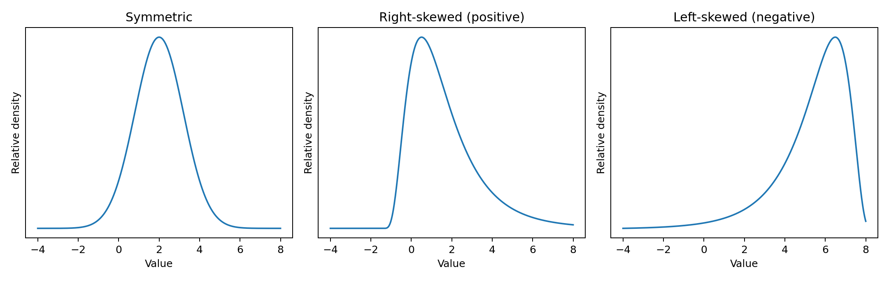
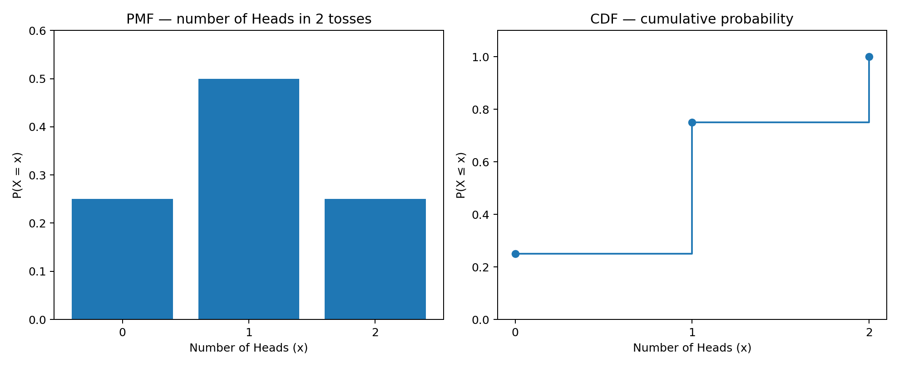
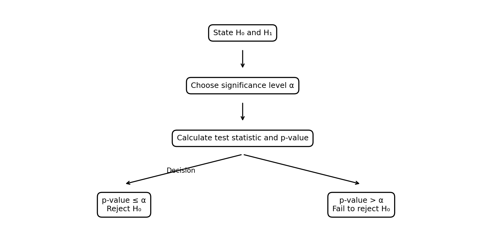

# Statistics — 22 November Class Notes

> Revision notes based on the professor's handwritten `22 nov.pdf` (one page).
> The order and terminology follow the source. Additional explanations and
> Python examples are marked separately.

## Folder structure

```text
Day_10_22_Nov_26_C10_Statistics/
│
├── README.md
│
└── images/
    ├── pmf_cdf_coin_toss.png
    ├── distribution_skewness.png
    └── hypothesis_test_decision.png
```

Keep the `images/` folder beside this README so the graphs render on GitHub.

## Contents

1. [Mean, Median and Mode in distribution shapes](#1-mean-median-and-mode-in-distribution-shapes)
2. [PMF — Probability Mass Function](#2-pmf--probability-mass-function)
3. [CDF — Cumulative Distribution Function](#3-cdf--cumulative-distribution-function)
4. [Population and Sample](#4-population-and-sample)
5. [Hypothesis Testing](#5-hypothesis-testing)
6. [Null and Alternative Hypotheses](#6-null-and-alternative-hypotheses)
7. [Three Forms of Alternative Hypothesis](#7-three-forms-of-alternative-hypothesis)
8. [Significance Level (α)](#8-significance-level-α)
9. [Test Statistic — Z-test](#9-test-statistic--z-test)
10. [P-value and Decision](#10-p-value-and-decision)
11. [Type I and Type II Errors](#11-type-i-and-type-ii-errors)
12. [Statistical Tests Mentioned](#12-statistical-tests-mentioned)
13. [Python Revision](#13-python-revision)
14. [Formula Sheet](#14-formula-sheet)
15. [Practice Questions](#15-practice-questions)

---

# 1. Mean, Median and Mode in distribution shapes

🧑‍🏫 **Professor's notes**

The professor connects the relative positions of mean, median and mode with the shape of a distribution.

| Distribution shape | Relationship |
|---|---|
| Symmetric distribution | Mean = Median = Mode |
| Right-skewed distribution (positive skewness) | Mean > Median > Mode |
| Left-skewed distribution (negative skewness) | Mean < Median < Mode |



💡 **How to remember**

- In a right-skewed distribution, the long tail extends to the right. Large values pull the mean to the right.
- In a left-skewed distribution, the long tail extends to the left. Small values pull the mean to the left.
- In a symmetric distribution, the three measures coincide for a unimodal symmetric distribution.

---

# 2. PMF — Probability Mass Function

🧑‍🏫 **Professor's notes**

**PMF = Probability Mass Function.**

It gives the probability of each possible value of a discrete random variable.

\[
\boxed{P(X=x)}
\]

The professor's example uses two coin tosses.

Possible outcomes:

| Outcome | Number of Heads |
|---|---:|
| HH | 2 |
| HT | 1 |
| TH | 1 |
| TT | 0 |

There are four equally likely outcomes.

Therefore:

| \(x\) (number of Heads) | Probability | Calculation |
|---:|---:|---|
| 0 | 0.25 | \(1/4\) |
| 1 | 0.50 | \(2/4\) |
| 2 | 0.25 | \(1/4\) |

The PMF is:

\[
P(X=0)=0.25
\]

\[
P(X=1)=0.50
\]

\[
P(X=2)=0.25
\]

**Important PMF properties**

1. Every probability is between 0 and 1.
2. The sum of all probabilities is 1.

\[
\sum_x P(X=x)=1
\]

For this example:

\[
0.25+0.50+0.25=1
\]



💡 **Interpretation:** PMF answers the question, "What is the probability of exactly this value?"

---

# 3. CDF — Cumulative Distribution Function

🧑‍🏫 **Professor's notes**

**CDF = Cumulative Distribution Function.**

It gives the probability that a random variable is less than or equal to a particular value.

\[
\boxed{F(x)=P(X\leq x)}
\]

Using the same coin-toss example:

| \(x\) | PMF: \(P(X=x)\) | CDF: \(P(X\leq x)\) |
|---:|---:|---:|
| 0 | 0.25 | 0.25 |
| 1 | 0.50 | 0.75 |
| 2 | 0.25 | 1.00 |

### Calculate the CDF step by step

At \(x=0\):

\[
F(0)=P(X\leq0)=P(X=0)=0.25
\]

At \(x=1\):

\[
F(1)=P(X\leq1)
\]

\[
= P(X=0)+P(X=1)
\]

\[
=0.25+0.50=0.75
\]

At \(x=2\):

\[
F(2)=P(X\leq2)
\]

\[
=0.25+0.50+0.25=1.00
\]

### PMF vs CDF

| PMF | CDF |
|---|---|
| Probability of an exact value | Cumulative probability up to a value |
| \(P(X=x)\) | \(P(X\leq x)\) |
| Individual probabilities | Running total of probabilities |

**Memory trick:**

- PMF = probability at one value.
- CDF = probability accumulated up to that value.

---

# 4. Population and Sample

🧑‍🏫 **Professor's notes**

**Population:** The complete group you want to study.

**Sample:** A smaller group selected from the population.

Example from the professor's notes: a group of students and their average salaries.

| Student | Average salary |
|---|---:|
| S1 | 4,800 |
| S2 | 5,000 |
| S3 | 4,150 |
| S4 | 4,900 |

These four observations can be treated as a sample if they are selected from a larger population of students.

## Population vs Sample notation

| Population parameter | Sample statistic |
|---|---|
| Mean: \(\mu\) | Mean: \(\bar{x}\) |
| Variance: \(\sigma^2\) | Variance: \(s^2\) |
| Standard deviation: \(\sigma\) | Standard deviation: \(s\) |
| Population size: \(N\) | Sample size: \(n\) |

**Important:** A parameter describes a population. A statistic is calculated from a sample.

💡 **Why use a sample?**

It may be impractical or expensive to collect data from every member of a population. A sample lets us estimate population characteristics.

---

# 5. Hypothesis Testing

🧑‍🏫 **Professor's notes**

Hypothesis testing is a statistical method used to evaluate a claim about a population using sample data.

The professor's example is a claim about average salary:

\[
\text{Claimed population mean: }\mu=5000
\]

A sample is collected, and its mean is compared with the claimed population mean.

The aim is to determine whether the sample provides sufficient evidence against the claim.

## General process

1. State the null hypothesis.
2. State the alternative hypothesis.
3. Choose a significance level (\(\alpha\)).
4. Calculate the test statistic.
5. Calculate or obtain the p-value.
6. Compare the p-value with \(\alpha\).
7. Make a statistical decision.



---

# 6. Null and Alternative Hypotheses

🧑‍🏫 **Professor's notes**

## 6.1 Null hypothesis (\(H_0\))

The null hypothesis represents the initial claim or reference assumption being tested.

Professor's example:

\[
\boxed{H_0:\mu=5000}
\]

## 6.2 Alternative hypothesis (\(H_1\) or \(H_a\))

The alternative hypothesis represents the competing claim.

For the professor's two-tailed example:

\[
\boxed{H_1:\mu\neq5000}
\]

The hypotheses must be stated about the population parameter, not simply the sample mean.

---

# 7. Three Forms of Alternative Hypothesis

🧑‍🏫 **Professor's notes**

The professor lists three forms:

## 7.1 Two-tailed test

Used when we want to test whether the population mean is different from a specified value in either direction.

\[
\boxed{H_1:\mu\neq\mu_0}
\]

## 7.2 Right-tailed test

Used when the alternative claim is that the population mean is greater than the specified value.

\[
\boxed{H_1:\mu>\mu_0}
\]

## 7.3 Left-tailed test

Used when the alternative claim is that the population mean is less than the specified value.

\[
\boxed{H_1:\mu<\mu_0}
\]

| Test | Alternative hypothesis | Direction |
|---|---|---|
| Two-tailed | \(\mu\neq\mu_0\) | Either direction |
| Right-tailed | \(\mu>\mu_0\) | Greater |
| Left-tailed | \(\mu<\mu_0\) | Less |

**Remember:** The alternative hypothesis determines whether the test is left-tailed, right-tailed or two-tailed.

---

# 8. Significance Level (α)

🧑‍🏫 **Professor's notes**

The professor writes:

\[
\boxed{\alpha=0.05}
\]

Common significance levels:

| Alpha | Percentage |
|---:|---:|
| 0.10 | 10% |
| 0.05 | 5% |
| 0.01 | 1% |

The significance level is the threshold used to decide whether the observed evidence is sufficiently inconsistent with the null hypothesis.

💡 **Interpretation:** When \(\alpha=0.05\), the test uses a 5% significance threshold.

The significance level is chosen before examining the test result.

---

# 9. Test Statistic — Z-test

🧑‍🏫 **Professor's notes**

The professor introduces the Z-test using a claimed population mean and an observed sample mean.

The general Z-statistic for a sample mean, when the population standard deviation is known, is:

\[
\boxed{Z=\frac{\bar{x}-\mu_0}{\sigma/\sqrt{n}}}
\]

Where:

| Symbol | Meaning |
|---|---|
| \(Z\) | Z-test statistic |
| \(\bar{x}\) | Sample mean |
| \(\mu_0\) | Mean specified by the null hypothesis |
| \(\sigma\) | Population standard deviation |
| \(n\) | Sample size |
| \(\sigma/\sqrt{n}\) | Standard error of the sample mean |

The numerator is the difference between the observed sample mean and the hypothesised population mean.

The denominator is the standard error.

## 9.1 Professor's example

The handwritten notes show:

- Claimed population mean: \(\mu_0=5000\)
- Sample mean: \(\bar{x}=5200\)
- Sample size: 200 (circled in the notes)
- Z-statistic: \(Z=2\)
- Significance level: \(\alpha=0.05\)

The professor's written Z-statistic is:

\[
\boxed{Z=2}
\]

The standard error details are not fully specified in the handwritten example, so the calculation cannot be independently reconstructed from the visible values alone.

💡 **Additional clarification:** The displayed Z formula is the conventional one-sample Z-test formula when the population standard deviation is known. If the population standard deviation is unknown and estimated from the sample, a one-sample t-test is generally used instead.

---

# 10. P-value and Decision

🧑‍🏫 **Professor's notes**

The p-value is compared with the significance level.

The professor's decision rules are:

\[
\boxed{p\text{-value}\leq\alpha\Rightarrow\text{Reject }H_0}
\]

\[
\boxed{p\text{-value}>\alpha\Rightarrow\text{Fail to reject }H_0}
\]

| Condition | Decision |
|---|---|
| p-value ≤ α | Reject the null hypothesis |
| p-value > α | Fail to reject the null hypothesis |

## 10.1 Professor's example

The notes show:

\[
Z=2,\qquad\alpha=0.05
\]

For a two-tailed Z-test:

\[
p=2P(Z_{\text{standard}}\geq2)
\]

\[
p\approx0.0455
\]

Since:

\[
0.0455<0.05
\]

The decision is:

\[
\boxed{\text{Reject }H_0}
\]

**Important source clarification:** The handwritten p-value appears to be approximately 0.03, but the exact handwriting is not fully clear. For \(Z=2\), the standard normal p-value is approximately 0.0455 for a two-tailed test and 0.0228 for a one-tailed test. The tail direction must be known before selecting the p-value.

## 10.2 What does a p-value mean?

A p-value is the probability, assuming the null hypothesis is true, of obtaining a test statistic at least as extreme as the one observed, in the direction(s) specified by the alternative hypothesis.

It does **not** mean:

- The probability that the null hypothesis is true.
- The probability that the result happened purely by chance.
- The size or practical importance of an effect.

---

# 11. Type I and Type II Errors

🧑‍🏫 **Professor's notes**

The professor uses the example:

- \(H_0\): The transaction is legitimate.
- \(H_1\): The transaction is fraudulent.

There are two possible decision errors.

## 11.1 Type I Error

A Type I error happens when we reject a true null hypothesis.

In the professor's example:

- The transaction is actually legitimate.
- We decide it is fraudulent.

This is a **false positive**.

\[
\boxed{\text{Type I Error}=\text{False Positive}}
\]

The probability of a Type I error is controlled by the significance level \(\alpha\), under the assumptions of the test.

## 11.2 Type II Error

A Type II error happens when we fail to reject a false null hypothesis.

In the professor's example:

- The transaction is actually fraudulent.
- We decide it is legitimate.

This is a **false negative**.

\[
\boxed{\text{Type II Error}=\text{False Negative}}
\]

Its probability is commonly denoted by \(\beta\).

## 11.3 Confusion table

| Actual situation | Decision | Result |
|---|---|---|
| Legitimate (\(H_0\) true) | Decide legitimate | Correct decision |
| Legitimate (\(H_0\) true) | Decide fraudulent | Type I error — false positive |
| Fraudulent (\(H_0\) false) | Decide legitimate | Type II error — false negative |
| Fraudulent (\(H_0\) false) | Decide fraudulent | Correct decision |

**Memory trick**

- Type I = False alarm.
- Type II = Missed detection.

---

# 12. Statistical Tests Mentioned

🧑‍🏫 **Professor's notes**

The notes mention these statistical tests:

- Z-test
- t-test
- Chi-square test

The visible worked example focuses on the Z-test.

💡 **Brief additional distinction**

| Test | Common purpose |
|---|---|
| Z-test | Test a population mean or proportion under suitable conditions |
| t-test | Test means when population standard deviation is unknown, under suitable assumptions |
| Chi-square test | Test categorical frequency relationships or goodness of fit |

The handwritten page does not provide worked examples for the t-test or chi-square test.

---

# 13. Python Revision

These examples implement the ideas from the class.

## 13.1 PMF and CDF

```python
import numpy as np

x = np.array([0, 1, 2])

pmf = np.array([0.25, 0.50, 0.25])

cdf = np.cumsum(pmf)

print("PMF:", pmf)
print("CDF:", cdf)
```

Output:

```text
PMF: [0.25 0.5  0.25]
CDF: [0.25 0.75 1.  ]
```

## 13.2 Calculate the Z-statistic

```python
import numpy as np

sample_mean = 5200
population_mean = 5000
population_std = 1414.213562
sample_size = 200

standard_error = population_std / np.sqrt(sample_size)

z = (sample_mean - population_mean) / standard_error

print("Standard error:", standard_error)
print("Z-statistic:", z)
```

This uses an illustrative population standard deviation to produce \(Z=2\). The professor's page does not clearly specify that standard deviation, so it is not claimed to be the original input.

## 13.3 Calculate a p-value

```python
from scipy.stats import norm

z = 2

# Two-tailed p-value
p_value_two_tailed = 2 * norm.sf(abs(z))

alpha = 0.05

print("P-value:", p_value_two_tailed)

if p_value_two_tailed <= alpha:
    print("Reject H0")
else:
    print("Fail to reject H0")
```

Expected output:

```text
P-value: 0.04550026389635839
Reject H0
```

For a right-tailed test:

```python
p_value = norm.sf(z)
```

For a left-tailed test:

```python
p_value = norm.cdf(z)
```

For a two-tailed test:

```python
p_value = 2 * norm.sf(abs(z))
```

---

# 14. Formula Sheet

| Concept | Formula |
|---|---|
| PMF | \(P(X=x)\) |
| PMF total probability | \(\sum_x P(X=x)=1\) |
| CDF | \(F(x)=P(X\leq x)\) |
| Standard error of mean | \(\frac{\sigma}{\sqrt n}\) |
| Z-statistic | \(\frac{\bar{x}-\mu_0}{\sigma/\sqrt n}\) |
| Null hypothesis example | \(H_0:\mu=5000\) |
| Two-tailed alternative | \(H_1:\mu\neq\mu_0\) |
| Right-tailed alternative | \(H_1:\mu>\mu_0\) |
| Left-tailed alternative | \(H_1:\mu<\mu_0\) |
| Reject \(H_0\) | \(p\text{-value}\leq\alpha\) |
| Fail to reject \(H_0\) | \(p\text{-value}>\alpha\) |

---

# 15. Practice Questions

Try solving these without looking at the answers first.

## A. PMF and CDF

1. What does PMF stand for?
2. What does CDF stand for?
3. What is the difference between PMF and CDF?
4. If the PMF values are `[0.2, 0.5, 0.3]`, calculate the CDF values.
5. Why must the sum of all PMF probabilities equal 1?

## B. Population and Sample

6. Define population.
7. Define sample.
8. What is the difference between a parameter and a statistic?
9. Which symbol represents the population mean?
10. Which symbol represents the sample mean?

## C. Hypothesis Testing

11. What is the null hypothesis?
12. What is the alternative hypothesis?
13. Write the alternative hypothesis for a right-tailed test.
14. Write the alternative hypothesis for a left-tailed test.
15. What is a two-tailed test?
16. What does \(\alpha=0.05\) mean?
17. If p-value = 0.03 and alpha = 0.05, what is the decision?
18. If p-value = 0.08 and alpha = 0.05, what is the decision?
19. What is a Type I error?
20. What is a Type II error?

## D. Calculation

21. A population mean is 5000, the sample mean is 5200, and the standard error is 100. Calculate Z.
22. For \(Z=2\), calculate the two-tailed p-value using the standard normal distribution.
23. If the p-value is 0.0455 and alpha is 0.05, what is the decision?
24. In fraud detection, what is the difference between a false positive and a false negative?

<details>
<summary><strong>Show answer key</strong></summary>

1. Probability Mass Function.
2. Cumulative Distribution Function.
3. PMF gives probability at an exact discrete value; CDF gives accumulated probability up to a value.
4. `[0.2, 0.7, 1.0]`.
5. The random variable must take one of its possible values, so total probability is 1.
6. The complete group being studied.
7. A smaller group selected from the population.
8. A parameter describes a population; a statistic describes a sample.
9. \(\mu\).
10. \(\bar{x}\).
11. The initial/reference claim being tested.
12. The competing claim.
13. \(H_1:\mu>\mu_0\).
14. \(H_1:\mu<\mu_0\).
15. A test for a difference in either direction: \(H_1:\mu\neq\mu_0\).
16. A 5% significance threshold.
17. Reject \(H_0\).
18. Fail to reject \(H_0\).
19. Rejecting a true null hypothesis; false positive.
20. Failing to reject a false null hypothesis; false negative.
21. \(Z=(5200-5000)/100=2\).
22. Approximately 0.0455.
23. Reject \(H_0\).
24. False positive: legitimate transaction flagged as fraud. False negative: fraudulent transaction treated as legitimate.

</details>

---

## Final Revision Checklist

- [ ] I understand the relationship between mean, median and mode.
- [ ] I can explain symmetric, right-skewed and left-skewed distributions.
- [ ] I understand PMF and can calculate its probabilities.
- [ ] I can calculate CDF using cumulative addition.
- [ ] I understand population vs sample.
- [ ] I can formulate \(H_0\) and \(H_1\).
- [ ] I can identify left-tailed, right-tailed and two-tailed tests.
- [ ] I understand significance level (\(\alpha\)).
- [ ] I can calculate a Z-statistic.
- [ ] I understand p-value and the decision rule.
- [ ] I can distinguish Type I and Type II errors.
- [ ] I can implement PMF, CDF and Z-test calculations in Python.

**Recommended revision order:** First practise PMF and CDF with small tables. Then learn the hypotheses and tail directions. Finally, practise Z-statistic, p-value and Type I/Type II errors.
