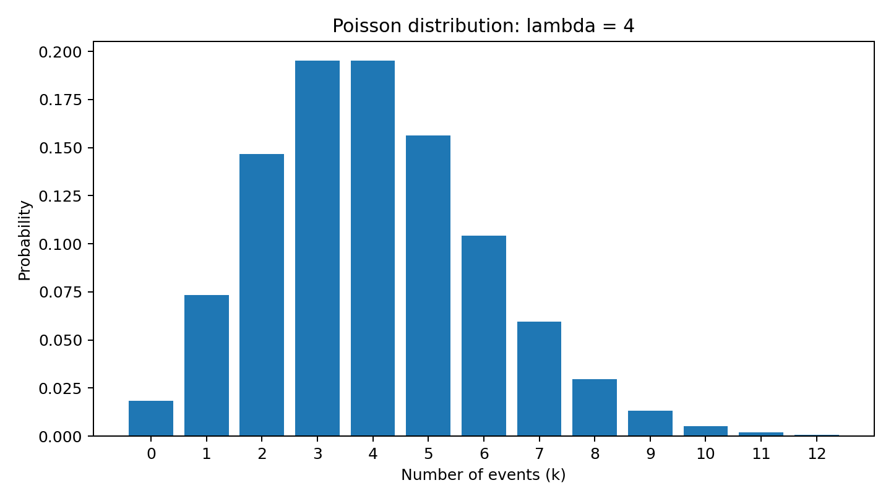

# Statistics -- 21 November Class Notes

> **Purpose:** A structured revision guide based primarily on the
> handwritten **21 Nov.pdf**. It preserves the professor's topic order,
> formulas, and worked examples, with additional explanations and Python
> implementations to make revision easier.

## How to use this README

-   **🧑‍🏫 Professor's notes:** Material explicitly present in the 21
    November class notes.
-   **💡 Explanation:** Extra explanation to make the professor's points
    easier to understand.
-   **🐍 Python:** Practical implementation using Python.
-   **🤖 AI/ML connection:** Why the concept matters in machine
    learning.

------------------------------------------------------------------------

## Contents

1.  [Statistics: the three areas](#1-statistics-the-three-areas)
2.  [Descriptive statistics](#2-descriptive-statistics)
3.  [Mean / average](#3-mean--average)
4.  [Median](#4-median)
5.  [Mode](#5-mode)
6.  [Measures of dispersion: range, variance, standard
    deviation](#6-measures-of-dispersion-range-variance-standard-deviation)
7.  [Normal distribution](#7-normal-distribution)
8.  [Binomial distribution](#8-binomial-distribution)
9.  [Poisson distribution](#9-poisson-distribution)
10. [Compare the three
    distributions](#10-compare-the-three-distributions)
11. [Python revision notebook](#11-python-revision-notebook)
12. [Formula sheet](#12-formula-sheet)
13. [Self-check questions](#13-self-check-questions)

------------------------------------------------------------------------

# 1. Statistics: the three areas

🧑‍🏫 **Professor's notes**

The page begins by listing three broad areas:

1.  Descriptive statistics
2.  Inferential statistics
3.  Probability and statistical modelling

💡 **Explanation**

  -----------------------------------------------------------------------
  Area                    Main purpose            Simple example
  ----------------------- ----------------------- -----------------------
  Descriptive statistics  Summarise the data we   Calculate the average
                          have                    of students' marks

  Inferential statistics  Use a sample to learn   Survey a sample of
                          about a larger          voters to estimate
                          population              public opinion

  Probability and         Describe uncertainty    Estimate the
  statistical modelling   and random outcomes     probability of a
                          mathematically          customer purchasing a
                                                  product
  -----------------------------------------------------------------------

**Learning order:** Start with descriptive statistics, then study
probability distributions. These foundations make inferential statistics
easier to understand.

# 2. Descriptive statistics

🧑‍🏫 **Professor's notes**

The professor groups descriptive statistics into:

-   **Measures of central tendency:** mean, median and mode.
-   **Measures of dispersion:** range, variance and standard deviation.

💡 **Explanation**

Central tendency describes the centre or typical value of a dataset.
Dispersion describes how spread out the observations are.

Consider:

``` text
Dataset A = [70, 75, 80, 85, 90]
Dataset B = [20, 50, 80, 110, 140]
```

Both datasets have a mean of 80, but Dataset B is much more spread out.
Therefore, the mean alone does not describe the whole dataset.

------------------------------------------------------------------------

# 3. Mean / average

🧑‍🏫 **Professor's notes -- formula**

The mean is the sum of all observations divided by the number of
observations.

\[ `\bar`{=tex}{x} = `\frac{\sum_{i=1}^{n} x_i}{n}`{=tex} \]

  Symbol              Meaning
  ------------------- ------------------------
  (`\bar`{=tex}{x})   Sample mean
  (x_i)               One observation
  (`\sum`{=tex})      Add all observations
  \(n\)               Number of observations

For a whole population, the notation is:

\[ `\mu `{=tex}= `\frac{\sum_{i=1}^{N}x_i}{N}`{=tex} \]

Here, (`\mu`{=tex}) is the population mean and (N) is the population
size.

## 3.1 Professor's example: marks

🧑‍🏫 The notes show:

``` text
[60, 70, 80, 90, 100]
```

**Step 1 -- Add the values**

\[ 60+70+80+90+100=400 \]

**Step 2 -- Count the values**

\[ n=5 \]

**Step 3 -- Divide**

\[ `\bar`{=tex}{x}=`\frac{400}{5}`{=tex}=`\boxed{80}`{=tex} \]

The mean is **80**.

## 3.2 Professor's example: average order value (AOV) and an outlier

🧑‍🏫 The written calculation uses five order values:

``` text
[500, 700, 800, 1000, 2000]
```

\[ AOV=`\frac{500+700+800+1000+2000}{5}`{=tex} =`\frac{5000}{5}`{=tex}
=`\boxed{1000}`{=tex} \]

The notes then add an unusually large order value of **1,000,000**:

``` text
[500, 700, 800, 1000, 2000, 1000000]
```

The new mean is:

\[ AOV=`\frac{5000+1000000}{6}`{=tex} =`\frac{1005000}{6}`{=tex}
=`\boxed{167500}`{=tex} \]

**Key lesson:** One extreme observation can pull the mean far away from
most of the data. Such an unusually distant observation is called an
**outlier**.

  Situation                               Mean
  ---------------------------------- ---------
  Five original orders                   1,000
  After adding the 1,000,000 order     167,500

The professor's notes also illustrate the effect on a 40% profit
calculation:

-   (40%) of 1,000 = 400
-   (40%) of 167,500 = 67,000

This illustrates why an outlier can affect business summaries and
decisions based on the mean.

## 3.3 Python

``` python
orders = [500, 700, 800, 1000, 2000]

mean = sum(orders) / len(orders)
print("Mean:", mean)

# Add the outlier
orders.append(1_000_000)

new_mean = sum(orders) / len(orders)
print("Mean after outlier:", new_mean)
```

Expected output:

``` text
Mean: 1000.0
Mean after outlier: 167500.0
```

## 3.4 AI/ML connection

-   Mean imputation: replace a missing numerical value with a feature's
    mean (when appropriate).
-   Mean centering: subtract the feature mean from each value.
-   PCA: uses variance around the mean to identify directions of high
    variation.

**Caution:** Mean imputation can be misleading when the feature is
strongly skewed or contains influential outliers.

------------------------------------------------------------------------

# 4. Median

🧑‍🏫 **Professor's notes**

The median is the **middle value** after arranging observations in
ascending or descending order.

**Always sort the values first.**

## 4.1 Odd number of observations

🧑‍🏫 The notes show this example:

``` text
Original: [10, 18, 5, 9, 25]
Sorted:   [5, 9, 10, 18, 25]
```

There are five observations. The middle position is:

\[ `\frac{n+1}{2}`{=tex}=`\frac{5+1}{2}`{=tex}=3 \]

The third value is 10.

\[ `\boxed{Median=10}`{=tex} \]

## 4.2 Even number of observations

When the number of observations is even, take the average of the two
middle values.

Example:

``` text
Original: [10, 18, 5, 9, 25, 2]
Sorted:   [2, 5, 9, 10, 18, 25]
```

The two middle values are 9 and 10.

\[ Median=`\frac{9+10}{2}`{=tex}=`\boxed{9.5}`{=tex} \]

## 4.3 General formulas

For odd (n):

\[ Median=X\_{`\left`{=tex}(`\frac{n+1}{2}`{=tex}`\right`{=tex})} \]

For even (n):

\[ Median=`\frac{X_{(n/2)}+X_{(n/2+1)}}{2}`{=tex} \]

Here, (X\_{(i)}) means the value at position (i) **after sorting**.

## 4.4 Why median is useful with outliers

``` text
Original: [500, 700, 800, 1000, 2000]
Median:   800

With outlier:
[500, 700, 800, 1000, 2000, 1000000]
Median:   (800 + 1000) / 2 = 900
```

The mean changes dramatically after adding the outlier, while the median
changes only from 800 to 900.

**Remember:** Median is generally more resistant to extreme values than
the mean.

## 4.5 Python

``` python
import numpy as np

data = [10, 18, 5, 9, 25]
print(np.median(data))  # 10.0

data_even = [10, 18, 5, 9, 25, 2]
print(np.median(data_even))  # 9.5
```

Manual implementation:

``` python
data = [10, 18, 5, 9, 25, 2]

data.sort()
n = len(data)

if n % 2 == 1:
    median = data[n // 2]
else:
    left = data[n // 2 - 1]
    right = data[n // 2]
    median = (left + right) / 2

print("Sorted:", data)
print("Median:", median)
```

## 4.6 AI/ML connection

-   Median imputation for numerical missing values.
-   Summarising skewed data.
-   Robust exploratory data analysis.
-   Describing typical income, prices or transaction amounts when
    outliers exist.

------------------------------------------------------------------------

# 5. Mode

🧑‍🏫 **Professor's notes**

Mode is the value that occurs most frequently.

The notes give this list:

``` text
[2, 3, 4, 5, 6, 7, 8, 7, 6, 5, 5, 1]
```

Count the occurrences:

    Value   Frequency
  ------- -----------
        1           1
        2           1
        3           1
        4           1
        5           3
        6           2
        7           2
        8           1

The value 5 appears most frequently.

\[ `\boxed{Mode=5}`{=tex} \]

## 5.1 Types of mode

  Type         Meaning                                      Example
  ------------ -------------------------------------------- ------------------------------
  Unimodal     One mode                                     `[1, 2, 2, 3]` → 2
  Bimodal      Two modes                                    `[1, 2, 2, 3, 3]` → 2 and 3
  Multimodal   More than two modes                          `[1,1,2,2,3,3]` → 1, 2 and 3
  No mode      No value occurs more often than the others   `[1,2,3,4]`

## 5.2 Python

``` python
from statistics import multimode

data = [2, 3, 4, 5, 6, 7, 8, 7, 6, 5, 5, 1]

print("Mode:", multimode(data))
```

Output:

``` text
Mode: [5]
```

## 5.3 AI/ML connection

Mode is especially useful for categorical features.

Example:

``` text
Payment methods = ["Card", "Cash", "Card", "Card", "Cash"]
```

The mode is `"Card"`. It can be used as a simple replacement for a
missing categorical value, provided that this choice makes sense for the
dataset.

------------------------------------------------------------------------

# 6. Measures of dispersion: range, variance, standard deviation

🧑‍🏫 **Professor's notes**

The notes identify range, variance and standard deviation as measures
describing how spread out the data is.

## 6.1 Range

Range is the difference between the maximum and minimum values.

\[ `\boxed{Range=X_{\max}-X_{\min}}`{=tex} \]

Example:

``` text
[10, 20, 30, 40, 50]
```

\[ Range=50-10=`\boxed{40}`{=tex} \]

Python:

``` python
data = [10, 20, 30, 40, 50]
data_range = max(data) - min(data)

print(data_range)  # 40
```

**Limitation:** Range uses only the two extreme values and is sensitive
to outliers.

## 6.2 Variance

Variance measures how far observations are spread around their mean.

### Why do we square deviations?

Suppose:

``` text
Data = [70, 75, 80, 85, 90]
Mean = 80
```

Subtract the mean from every observation:

    Observation (x_i)   Deviation (x_i-`\mu`{=tex})   Squared deviation
  ------------------- ----------------------------- -------------------
                   70                           -10                 100
                   75                            -5                  25
                   80                             0                   0
                   85                            +5                  25
                   90                           +10                 100
            **Total**                         **0**             **250**

The positive and negative deviations cancel when added directly.
Squaring makes every contribution non-negative.

### Population variance -- professor's calculation

\[ `\boxed{\sigma^2=\frac{\sum_{i=1}^{N}(x_i-\mu)^2}{N}}`{=tex} \]

For the example:

\[ `\sigma`{=tex}\^2=`\frac{100+25+0+25+100}{5}`{=tex} \]

\[ =`\frac{250}{5}`{=tex} =`\boxed{50}`{=tex} \]

🧑‍🏫 **This matches the population-variance calculation in the professor's
Class A example.**

### Sample variance -- additional clarification

When the observations are a sample used to estimate a larger
population's variance, the usual unbiased sample variance is:

\[ `\boxed{s^2=\frac{\sum_{i=1}^{n}(x_i-\bar{x})^2}{n-1}}`{=tex} \]

For the same values:

\[ s\^2=`\frac{250}{5-1}`{=tex}=`\boxed{62.5}`{=tex} \]

**Do not mix the denominators:**

-   Population variance: divide by (N).
-   Sample variance: divide by (n-1).

## 6.3 Professor's Class A vs Class B example

🧑‍🏫 The notes compare two classes:

``` text
Class A = [70, 75, 80, 85, 90]
Class B = [20, 50, 80, 110, 140]
```

Both have the same mean:

\[ Mean(A)=Mean(B)=80 \]

For Class A:

\[ `\sigma`{=tex}\_A\^2=50 \]

\[ `\sigma`{=tex}\_A=`\sqrt{50}`{=tex}`\approx7.07`{=tex} \]

The notes explicitly show the Class A variance and standard-deviation
calculation.

**Additional calculation for Class B:**

\[ `\sigma`{=tex}\_B\^2= `\frac{3600+900+0+900+3600}{5}`{=tex}
=`\boxed{1800}`{=tex} \]

\[
`\sigma`{=tex}\_B=`\sqrt{1800}`{=tex}`\approx`{=tex}`\boxed{42.43}`{=tex}
\]

  Measure                           Class A   Class B
  ------------------------------- --------- ---------
  Mean                                   80        80
  Population variance                    50     1,800
  Population standard deviation        7.07     42.43

**Interpretation:** Both classes have the same average, but Class B's
values are much more spread out.

## 6.4 Standard deviation

Standard deviation is the square root of variance.

Population:

\[ `\boxed{\sigma=\sqrt{\frac{\sum(x_i-\mu)^2}{N}}}`{=tex} \]

Sample:

\[ `\boxed{s=\sqrt{\frac{\sum(x_i-\bar{x})^2}{n-1}}}`{=tex} \]

For Class A:

\[ `\sigma`{=tex}=`\sqrt{50}`{=tex}`\approx`{=tex}`\boxed{7.07}`{=tex}
\]

**Why take the square root?** Variance is expressed in squared units.
Standard deviation returns the measure to the original unit of the data,
making it easier to interpret.

## 6.5 Python: population and sample calculations

``` python
import numpy as np

class_a = [70, 75, 80, 85, 90]

# Population calculations
population_variance = np.var(class_a)
population_std = np.std(class_a)

# Sample calculations
sample_variance = np.var(class_a, ddof=1)
sample_std = np.std(class_a, ddof=1)

print("Population variance:", population_variance)
print("Population SD:", population_std)

print("Sample variance:", sample_variance)
print("Sample SD:", sample_std)
```

Expected output:

``` text
Population variance: 50.0
Population SD: 7.0710678118654755

Sample variance: 62.5
Sample SD: 7.905694150420948
```

`ddof=1` tells NumPy to use (n-1) in the denominator.

## 6.6 AI/ML connection

-   **Feature variance:** A feature with zero variance has the same
    value for every row and normally provides no ability to distinguish
    observations.
-   **PCA:** Uses variance to identify directions that explain variation
    in the data.
-   **Standardisation:** Uses the mean and standard deviation to put
    features on comparable scales.
-   **Bias--variance trade-off:** High model variance is associated with
    sensitivity to changes in training data and can contribute to
    overfitting.

### Standardisation formula

\[ `\boxed{z=\frac{x-\mu}{\sigma}}`{=tex} \]

Python:

``` python
from sklearn.preprocessing import StandardScaler

X = [[20, 20000],
     [30, 40000],
     [40, 60000]]

scaler = StandardScaler()
X_scaled = scaler.fit_transform(X)

print(X_scaled)
```

------------------------------------------------------------------------

# 7. Normal distribution

🧑‍🏫 **Professor's notes**

The notes introduce the normal distribution with a bell-shaped curve and
the **68--95--99.7 rule**.

A normal distribution is a continuous, symmetric, bell-shaped
probability distribution.

It is also called the Gaussian distribution.

## 7.1 Important properties

1.  The curve is symmetric around the mean.
2.  Mean = Median = Mode.
3.  The total area under the curve is 1.
4.  The mean determines the centre.
5.  Standard deviation determines the spread.


## 7.2 Parameters

A normal distribution is described by:

-   (`\mu`{=tex}): mean.
-   (`\sigma`{=tex}): standard deviation.

Notation:

\[ X`\sim `{=tex}N(`\mu`{=tex},`\sigma`{=tex}\^2) \]

The second parameter is the **variance**, not the standard deviation.

## 7.3 Professor's 68--95--99.7 rule

🧑‍🏫 **Memorise this rule.**

For normally distributed data:

  Interval                                    Approximate percentage
  ----------------------------------------- ------------------------
  (`\mu`{=tex}`\pm1`{=tex}`\sigma`{=tex})                        68%
  (`\mu`{=tex}`\pm2`{=tex}`\sigma`{=tex})                        95%
  (`\mu`{=tex}`\pm3`{=tex}`\sigma`{=tex})                      99.7%

## 7.4 Professor's numerical example

🧑‍🏫 The notes use:

\[ `\mu=70`{=tex},`\qquad `{=tex}`\sigma=10`{=tex} \]

**Within 1 standard deviation:**

\[ 70-10=60,`\qquad70`{=tex}+10=80 \]

Approximately 68% of values lie between 60 and 80.

**Within 2 standard deviations:**

\[ 70-2(10)=50 \]

\[ 70+2(10)=90 \]

Approximately 95% lie between 50 and 90.

**Within 3 standard deviations:**

\[ 70-3(10)=40 \]

\[ 70+3(10)=100 \]

Approximately 99.7% lie between 40 and 100.

### Quick revision table

  Range                                       Lower boundary   Upper boundary   Approx. coverage
  ----------------------------------------- ---------------- ---------------- ------------------
  (`\mu`{=tex}`\pm1`{=tex}`\sigma`{=tex})                 60               80                68%
  (`\mu`{=tex}`\pm2`{=tex}`\sigma`{=tex})                 50               90                95%
  (`\mu`{=tex}`\pm3`{=tex}`\sigma`{=tex})                 40              100              99.7%

## 7.5 Z-score connection

A Z-score tells us how many standard deviations an observation is from
the mean.

\[ `\boxed{z=\frac{x-\mu}{\sigma}}`{=tex} \]

Example: (x=90,`\mu=70`{=tex},`\sigma=10`{=tex})

\[ z=`\frac{90-70}{10}`{=tex}=`\boxed{2}`{=tex} \]

The value 90 is two standard deviations above the mean.

## 7.6 Python

``` python
import numpy as np
from scipy.stats import norm

mu = 70
sigma = 10

# Probability between 60 and 80
probability = (
    norm.cdf(80, loc=mu, scale=sigma)
    - norm.cdf(60, loc=mu, scale=sigma)
)

print(probability)
```

Expected result is approximately `0.6827`.

Generate and plot sample data:

``` python
import numpy as np
import matplotlib.pyplot as plt

data = np.random.normal(
    loc=70,
    scale=10,
    size=10000
)

plt.hist(data, bins=40, density=True)
plt.xlabel("Value")
plt.ylabel("Density")
plt.title("Simulated normal distribution")
plt.show()
```

## 7.7 AI/ML connection

-   Gaussian Naive Bayes.
-   Gaussian Mixture Models (GMM).
-   Noise modelling.
-   Some anomaly-detection methods.
-   Probabilistic modelling.

**Connection to EEG research:** Gaussian models can help represent the
distributions of numerical EEG features. A Gaussian Mixture Model can
represent more complex distributions as combinations of Gaussian
components. Real EEG features are not automatically normally
distributed; inspect the data before assuming normality.

------------------------------------------------------------------------

# 8. Binomial distribution

🧑‍🏫 **Professor's notes**

The notes show the binomial probability formula:

\[ `\boxed{P(X=k)=\binom{n}{k}p^k(1-p)^{n-k}}`{=tex} \]

A binomial distribution calculates the probability of obtaining exactly
(k) successes in (n) independent trials, when every trial has the same
probability of success.

## 8.1 Four conditions

1.  Fixed number of trials.
2.  Two possible outcomes per trial: success or failure.
3.  Constant probability of success.
4.  Independent trials.

Example: Tossing a fair coin five times.

-   Trial: one coin toss.
-   Success: Head.
-   Failure: Tail.
-   (n=5).
-   (p=0.5).

## 8.2 Understand the formula

  Symbol                Meaning
  --------------------- ------------------------------------------------
  (P(X=k))              Probability of exactly (k) successes
  \(n\)                 Number of trials
  \(k\)                 Required successes
  \(p\)                 Probability of success
  (1-p)                 Probability of failure
  (`\binom `{=tex}nk)   Number of ways to choose the success positions

Combination:

\[ `\binom `{=tex}nk=`\frac{n!}{k!(n-k)!}`{=tex} \]

Factorial example:

\[ 5!=5`\times4`{=tex}`\times3`{=tex}`\times2`{=tex}`\times1`{=tex}=120
\]

## 8.3 Worked example: exactly 2 Heads in 5 tosses

Given:

\[ n=5,`\quad `{=tex}k=2,`\quad `{=tex}p=0.5 \]

Substitute:

\[ P(X=2)=`\binom52`{=tex}(0.5)^2(0.5)^3 \]

Combination:

\[ `\binom52`{=tex}=`\frac{5!}{2!3!}`{=tex}=10 \]

Powers:

\[ (0.5)^2=0.25,`\qquad`{=tex}(0.5)^3=0.125 \]

Multiply:

\[ P(X=2)=10`\times0.25`{=tex}`\times0.125`{=tex} \]

\[ `\boxed{P(X=2)=0.3125=31.25\%}`{=tex} \]


## 8.4 Mean, variance and standard deviation

\[ `\boxed{Mean=np}`{=tex} \]

\[ `\boxed{Variance=np(1-p)}`{=tex} \]

\[ `\boxed{SD=\sqrt{np(1-p)}}`{=tex} \]

For (n=5,p=0.5):

\[ Mean=5(0.5)=2.5 \]

\[ Variance=5(0.5)(0.5)=1.25 \]

\[ SD=`\sqrt{1.25}`{=tex}`\approx1.118`{=tex} \]

## 8.5 Python

``` python
from scipy.stats import binom

n = 5
p = 0.5
k = 2

# Exactly k successes
exactly = binom.pmf(k, n, p)

# At most k successes: P(X <= k)
at_most = binom.cdf(k, n, p)

# More than k successes: P(X > k)
more_than = binom.sf(k, n, p)

print("Exactly 2:", exactly)
print("At most 2:", at_most)
print("More than 2:", more_than)
```

Useful terminology:

  Wording       Expression             SciPy
  ------------- ---------------------- ---------------------
  Exactly k     (P(X=k))               `binom.pmf(k,n,p)`
  At most k     (P(X`\leq `{=tex}k))   `binom.cdf(k,n,p)`
  More than k   (P(X\>k))              `binom.sf(k,n,p)`
  At least k    (P(X`\geq `{=tex}k))   `binom.sf(k-1,n,p)`

## 8.6 AI/ML connection

-   Binary outcomes and Bernoulli trials.
-   Number of correct predictions in a fixed batch, under independence
    and constant success probability.
-   Conversion and click-count modelling.
-   Binomial likelihood for binary outcome data.

------------------------------------------------------------------------

# 9. Poisson distribution

🧑‍🏫 **Professor's notes**

The notes give the Poisson formula:

\[ `\boxed{P(X=k)=\frac{e^{-\lambda}\lambda^k}{k!}}`{=tex} \]

Poisson distribution models the number of events occurring in a fixed
interval of time, space or another measurement, under suitable
assumptions.

The professor's example asks:

**How many calls arrive in one minute?**

## 9.1 Understand lambda ((`\lambda`{=tex}))

(`\lambda`{=tex}) represents the expected number of events in the
interval.

Example:

A call centre receives an average of 4 calls per minute.

\[ `\lambda=4`{=tex} \]

We want the probability of exactly 2 calls in one minute.

## 9.2 Understand the formula

  Symbol              Meaning
  ------------------- -----------------------------------------
  (P(X=k))            Probability of exactly k events
  \(k\)               Required event count
  (`\lambda`{=tex})   Average event count per interval
  \(e\)               Euler's constant, approximately 2.71828
  (k!)                Factorial of k

## 9.3 Worked example: exactly 2 calls

Given:

\[ `\lambda=4`{=tex},`\qquad `{=tex}k=2 \]

Substitute:

\[ P(X=2)=`\frac{e^{-4}4^2}{2!}`{=tex} \]

\[ =`\frac{e^{-4}\times16}{2}`{=tex} \]

\[ =8e\^{-4} \]

Since (e\^{-4}`\approx0.0183156`{=tex}):

\[ P(X=2)`\approx8`{=tex}(0.0183156) \]

\[ `\boxed{P(X=2)\approx0.1465=14.65\%}`{=tex} \]



## 9.4 Mean, variance and standard deviation

A special property of the Poisson distribution:

\[ `\boxed{Mean=\lambda}`{=tex} \]

\[ `\boxed{Variance=\lambda}`{=tex} \]

\[ `\boxed{SD=\sqrt{\lambda}}`{=tex} \]

For (`\lambda=4`{=tex}):

-   Mean = 4
-   Variance = 4
-   Standard deviation = 2

## 9.5 Conditions and assumptions

A standard Poisson model is appropriate when:

1.  We count events in a defined interval.
2.  Events occur independently.
3.  The average event rate is stable over the interval.
4.  Events occur individually, rather than in simultaneous clusters.

If events are clustered or the rate changes significantly, a standard
Poisson model may not fit well.

## 9.6 Python

``` python
from scipy.stats import poisson

lam = 4
k = 2

# Exactly 2 events
exactly = poisson.pmf(k, lam)

# At most 2 events
at_most = poisson.cdf(k, lam)

# More than 2 events
more_than = poisson.sf(k, lam)

print("Exactly 2:", exactly)
print("At most 2:", at_most)
print("More than 2:", more_than)
```

## 9.7 AI/ML connection

-   Website request counts.
-   Customer arrival counts.
-   Network event counts.
-   Accident frequency.
-   Count-data forecasting.

------------------------------------------------------------------------

# 10. Compare the three distributions

🧑‍🏫 **Professor's comparison table**

The professor compares the distributions by type and by the question
each distribution answers.

  -----------------------------------------------------------------------
  Distribution            Type                    Main question
  ----------------------- ----------------------- -----------------------
  Normal                  Continuous              How are continuous
                                                  values distributed?

  Binomial                Discrete                How many successes
                                                  occur in a fixed number
                                                  of trials?

  Poisson                 Discrete                How many events occur
                                                  in a fixed interval?
  -----------------------------------------------------------------------

## 10.1 Formula comparison

  Property          Normal                         Binomial                 Poisson
  ----------------- ------------------------------ ------------------------ ------------------------
  Parameters        (`\mu`{=tex},`\sigma`{=tex})   (n,p)                    (`\lambda`{=tex})
  Type              Continuous                     Discrete                 Discrete
  Possible values   Real numbers                   (0,1,`\ldots`{=tex},n)   (0,1,2,`\ldots`{=tex})
  Mean              (`\mu`{=tex})                  (np)                     (`\lambda`{=tex})
  Variance          (`\sigma`{=tex}\^2)            (np(1-p))                (`\lambda`{=tex})

## 10.2 How to choose the distribution

``` text
What are you modelling?
|
|-- Continuous measurements
|      |
|      +-- Consider Normal distribution
|
|-- Number of successes in fixed independent trials
|      |
|      +-- Consider Binomial distribution
|
+-- Number of events in a fixed interval
       |
       +-- Consider Poisson distribution
```

## 10.3 Binomial-to-Poisson approximation

Poisson can approximate a binomial distribution when:

-   \(n\) is large.
-   \(p\) is small.
-   (np) remains moderate.

The approximation uses:

\[ `\boxed{\lambda=np}`{=tex} \]

Example:

\[ n=1000,`\qquad `{=tex}p=0.002 \]

\[ `\lambda=1000`{=tex}(0.002)=2 \]

So:

\[ Binomial(1000,0.002)`\approx `{=tex}Poisson(2) \]

This is an approximation, not an identity.

------------------------------------------------------------------------

# 11. Python revision notebook

The following is a compact implementation of the major topics from this
class.

``` python
import numpy as np
import statistics
from scipy.stats import norm, binom, poisson

# ==========================================
# 1. DESCRIPTIVE STATISTICS
# ==========================================

data = [70, 75, 80, 85, 90]

print("Mean:", np.mean(data))
print("Median:", np.median(data))
print("Mode:", statistics.multimode(data))
print("Range:", max(data) - min(data))

print("Population variance:", np.var(data))
print("Population SD:", np.std(data))

print("Sample variance:", np.var(data, ddof=1))
print("Sample SD:", np.std(data, ddof=1))


# ==========================================
# 2. NORMAL DISTRIBUTION
# ==========================================

mu = 70
sigma = 10

# Probability between 60 and 80
normal_probability = (
    norm.cdf(80, loc=mu, scale=sigma)
    - norm.cdf(60, loc=mu, scale=sigma)
)

print("Normal probability:", normal_probability)


# ==========================================
# 3. BINOMIAL DISTRIBUTION
# ==========================================

n = 5
p = 0.5
k = 2

binomial_probability = binom.pmf(k, n, p)

print("Binomial probability:", binomial_probability)


# ==========================================
# 4. POISSON DISTRIBUTION
# ==========================================

lam = 4
k = 2

poisson_probability = poisson.pmf(k, lam)

print("Poisson probability:", poisson_probability)
```

Install the required libraries:

``` bash
pip install numpy scipy matplotlib scikit-learn
```

------------------------------------------------------------------------

# 12. Formula sheet

## Descriptive statistics

  Concept               Formula
  --------------------- -------------------------------------------------------
  Mean                  (`\bar`{=tex}{x}=`\frac{\sum x_i}{n}`{=tex})
  Median, odd n         (X\_{((n+1)/2)}) after sorting
  Median, even n        (`\frac{X_{(n/2)}+X_{(n/2+1)}}{2}`{=tex})
  Mode                  Most frequent value
  Range                 (X\_{`\max`{=tex}}-X\_{`\min`{=tex}})
  Population variance   (`\sigma`{=tex}\^2=`\frac{\sum(x_i-\mu)^2}{N}`{=tex})
  Sample variance       (s\^2=`\frac{\sum(x_i-\bar{x})^2}{n-1}`{=tex})
  Population SD         (`\sigma`{=tex}=`\sqrt{\sigma^2}`{=tex})
  Sample SD             (s=`\sqrt{s^2}`{=tex})
  Z-score               (z=`\frac{x-\mu}{\sigma}`{=tex})

## Probability distributions

  Concept                Formula
  ---------------------- ---------------------------------------------------
  Normal distribution    (X`\sim `{=tex}N(`\mu`{=tex},`\sigma`{=tex}\^2))
  Empirical rule         68% / 95% / 99.7%
  Binomial probability   (P(X=k)=`\binom `{=tex}nkp^k(1-p)^{n-k})
  Binomial mean          (np)
  Binomial variance      (np(1-p))
  Binomial SD            (`\sqrt{np(1-p)}`{=tex})
  Poisson probability    (P(X=k)=`\frac{e^{-\lambda}\lambda^k}{k!}`{=tex})
  Poisson mean           (`\lambda`{=tex})
  Poisson variance       (`\lambda`{=tex})
  Poisson SD             (`\sqrt{\lambda}`{=tex})

------------------------------------------------------------------------

# 13. Self-check questions

Try to answer these without looking at the solutions.

### A. Descriptive statistics

1.  Calculate the mean of `[10, 20, 30, 40, 50]`.
2.  Find the median of `[10, 20, 30, 40]`.
3.  Find the mode of `[2, 3, 3, 4, 5, 3, 6]`.
4.  Calculate the range of `[12, 18, 25, 30, 40]`.
5.  For `[70, 75, 80, 85, 90]`, calculate population variance and
    population standard deviation.
6.  Explain why median is less affected by an extreme outlier than mean.
7.  What is the difference between population variance and sample
    variance?

### B. Probability distributions

8.  A normal distribution has mean 100 and SD 15. What interval contains
    approximately 68% of observations?
9.  A fair coin is tossed 4 times. What is the probability of exactly 2
    Heads?
10. A machine has a defect probability of 0.1. For 5 independent
    products, calculate the probability of exactly 1 defective product.
11. A call centre receives an average of 3 calls per minute. What is the
    probability of exactly 2 calls in one minute?
12. Which distribution is suitable for counting successes in a fixed
    number of independent trials?
13. Which distribution is suitable for modelling event counts in a fixed
    interval?
14. What is the relationship between the mean and variance of a Poisson
    distribution?

### Answer key

```{=html}
<details>
```
```{=html}
<summary>
```
Show answers
```{=html}
</summary>
```
1.  30
2.  25
3.  3
4.  28
5.  Population variance = 50; population SD ≈ 7.071
6.  Median depends on the middle position, not the magnitude of extreme
    observations.
7.  Population variance divides by (N); sample variance typically
    divides by (n-1).
8.  85 to 115
9.  0.375 (37.5%)
10. (5(0.1)(0.9)\^4=0.32805) (32.805%)
11. (e^{-3}3^2/2!`\approx0.2240`{=tex}) (22.40%)
12. Binomial
13. Poisson
14. They are both equal to (`\lambda`{=tex}).

```{=html}
</details>
```

------------------------------------------------------------------------

## Final revision checklist

-   [ ] I can explain descriptive and inferential statistics.
-   [ ] I can calculate mean, median and mode manually.
-   [ ] I understand how outliers affect mean.
-   [ ] I can calculate range, variance and standard deviation.
-   [ ] I understand population versus sample variance.
-   [ ] I can explain the normal distribution and empirical rule.
-   [ ] I can calculate a Z-score.
-   [ ] I understand the four binomial conditions.
-   [ ] I can solve a binomial probability problem.
-   [ ] I understand Poisson probability and lambda.
-   [ ] I can distinguish Normal, Binomial and Poisson distributions.
-   [ ] I can implement the calculations using Python.

------------------------------------------------------------------------

## Connection to the next class

The next set of notes (22 November) moves into probability and
statistical inference:

-   PMF and CDF
-   Population and sample
-   Null and alternative hypotheses
-   One-tailed and two-tailed tests
-   Significance level
-   Test statistic and Z-test
-   P-value
-   Type I and Type II errors

**Recommended study method:** First work through the professor's
numerical examples by hand. Then run the Python code and change the
values to see how the results change.
